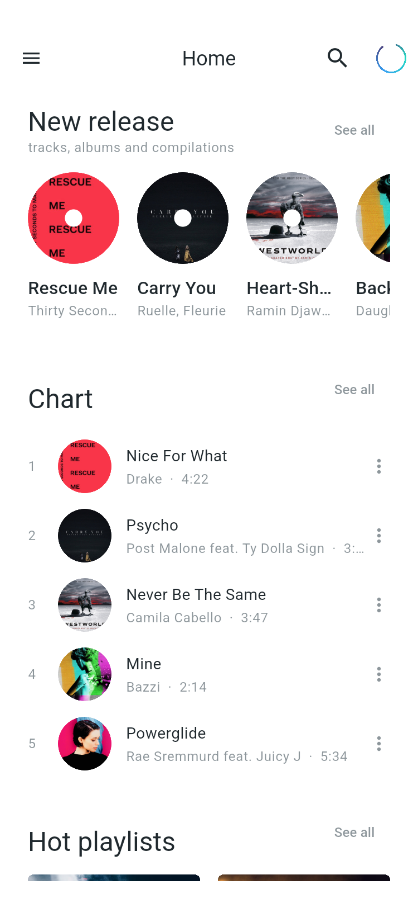
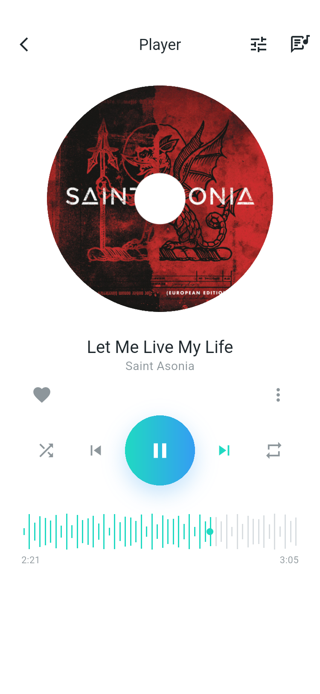
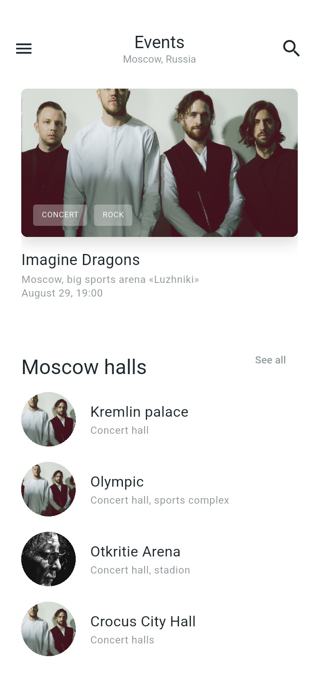
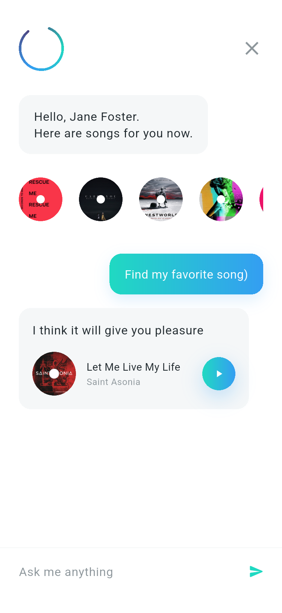
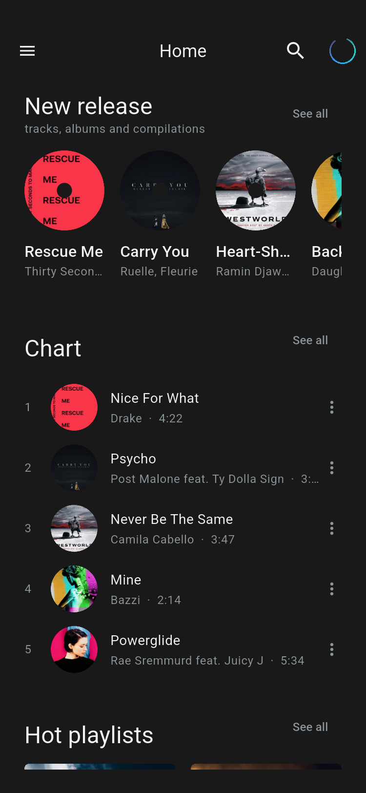
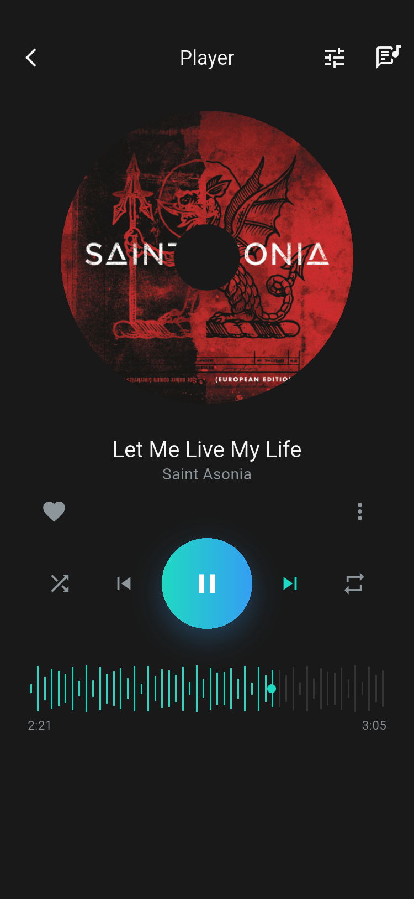
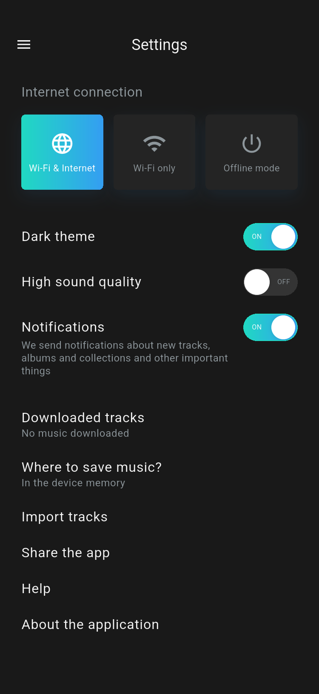
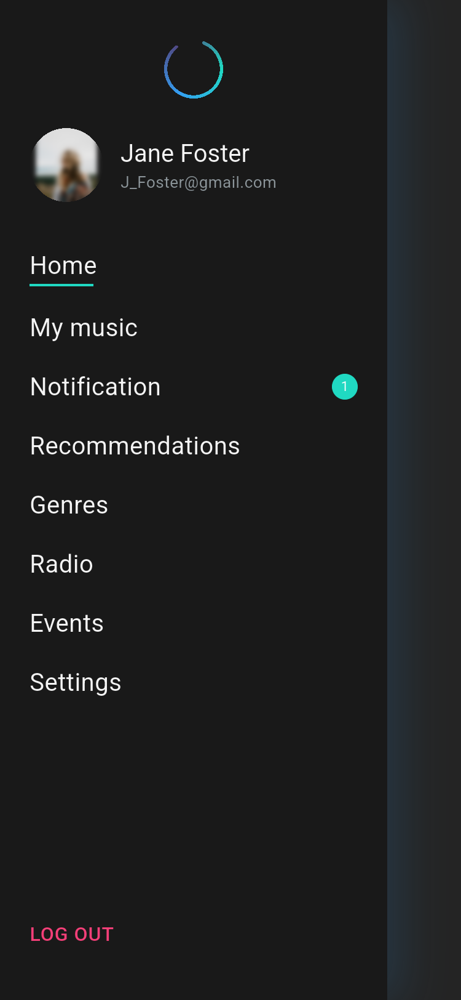

# Aura Music Servis

基于 Pixso 参考文件 **Music servise_light** 与 **Music servis_dark** 实现的 Flutter 音乐服务 App。项目覆盖设计中的引导、注册登录、音乐发现、播放器、识曲、活动购票、Aura 助手、个人中心与设置等界面，并支持亮色/暗色主题切换。

## 交付内容

- 45 个设计界面，使用 41 个命名路由和 5 屏引导 `PageView` 实现。
- 页面由 Flutter 组件、本地图片资源和 `CustomPainter` 构成，不是整屏设计图展示。
- 支持表单验证、曲风选择、播放状态、歌词模式、均衡器、座位选择、支付流程和 Aura 本地对话等演示交互。
- 亮色与暗色双主题：按 **Music servis_dark** 设计实现 `AppPalette` 主题扩展，可在设置页一键切换，全部 45 个界面随主题重绘。
- 45 张亮色 + 45 张暗色 Android 模拟器实渲染截图，分辨率为 750 × 1624。
- Pixso 原始参考图、亮/暗应用截图联系表、单元测试、主题切换 Widget 测试和 Android 端到端流程测试。

## 主要界面

| 首页与音乐发现 | 播放器 |
| --- | --- |
|  |  |

| 活动列表 | Aura 音乐助手 |
| --- | --- |
|  |  |

暗色主题下同一组界面（首页、播放器、设置、菜单）：

| 首页（暗色） | 播放器（暗色） |
| --- | --- |
|  |  |

| 设置（暗色） | 菜单（暗色） |
| --- | --- |
|  |  |

## 功能模块

| 模块 | 已实现内容 |
| --- | --- |
| 引导与认证 | 5 屏滑动引导、注册、登录、密码显隐、表单验证、偏好曲风与歌曲选择 |
| 首页与发现 | 新碟、推荐、榜单、Single/Album 切换、专辑、艺人、电台、曲风列表 |
| 音乐库与播放器 | 我的音乐、播放/暂停、喜欢、随机播放、波形、均衡器、普通歌词与 Karaoke |
| 搜索与识曲 | 搜索历史、曲风入口、识曲初始/监听/结果三个状态 |
| 活动购票 | 活动列表、详情、场馆选区、座位选择、数量与总价、支付、电子票条码 |
| Aura 助手 | 推荐唱片、对话输入、本地规则回复、推荐歌曲卡片 |
| 个人中心 | 抽屉菜单、个人资料、订阅、设置开关与退出入口 |

## 项目结构

```text
MusicServis/
├── android/                         # Android 平台工程
├── assets/
│   └── images/                      # 从 Pixso 导出的封面、人物与引导图片
├── docs/
│   ├── design_reference/            # 45 张 Pixso 亮色原始设计参考图
│   ├── design_reference_dark/       # Pixso 暗色设计参考图
│   ├── screenshots/                 # 45 张亮色 Android 实渲染界面截图
│   ├── screenshots_dark/            # 45 张暗色 Android 实渲染界面截图
│   ├── design_contact_*.jpg         # 原始设计联系表
│   ├── app_contact_*.jpg            # 亮色应用截图联系表
│   └── app_dark_contact_*.jpg       # 暗色应用截图联系表
├── integration_test/
│   ├── app_flow_test.dart           # 注册、购票、播放器与 Aura 端到端测试
│   └── screenshot_test.dart         # 自动遍历并截取全部界面
├── lib/
│   ├── core/
│   │   ├── routes.dart              # 41 个路由常量
│   │   └── theme.dart               # 亮/暗 AppPalette 主题扩展与全局主题控制器
│   ├── data/
│   │   └── demo_data.dart           # Track、Album 模型与本地演示数据
│   ├── features/
│   │   ├── assistant/aura_pages.dart
│   │   ├── auth/auth_pages.dart
│   │   ├── events/event_pages.dart
│   │   ├── home/home_pages.dart
│   │   ├── home/detail_pages.dart
│   │   ├── home/discovery_pages.dart
│   │   ├── music/library_pages.dart
│   │   ├── music/player_pages.dart
│   │   ├── music/search_pages.dart
│   │   ├── onboarding/onboarding_pages.dart
│   │   └── profile/profile_pages.dart
│   ├── shared/
│   │   └── widgets.dart             # 公共按钮、封面、曲目、波形等组件
│   └── main.dart                    # 应用入口与路由注册
├── test/
│   └── widget_test.dart             # 引导流程与亮/暗主题切换 Widget 测试
├── test_driver/
│   └── screenshot_driver.dart       # 按 SCREENSHOT_DIR 保存亮色或暗色截图
├── pubspec.yaml                     # 依赖与图片资源声明
└── README.md
```

## 架构说明

### 1. 分层职责

```text
MusicServisApp / MaterialApp
            │
            ▼
       AppRoutes 命名路由
            │
            ▼
      features 业务页面
       │            │
       ▼            ▼
 shared 公共组件   data 本地模型与演示数据
       │
       ▼
 core/theme 统一视觉规范
```

- `core`：只放全局路由和视觉主题，不承载业务状态。`theme.dart` 定义 `AppPalette`（ThemeExtension）与 `AppThemeController`/`AppThemeScope`，是亮/暗双主题的唯一来源。
- `data`：提供轻量不可变模型与本地数据，当前版本不依赖网络或数据库。
- `shared`：复用 `CoverImage`、`TrackTile`、`AlbumCard`、`GradientButton`、`PlayButton` 等 UI。
- `features`：按业务边界组织页面；相似设计变体共享实现，避免为 45 个界面重复代码。
- `main.dart`：创建应用、注册路由，并用 `AppThemeScope` 包裹 `MaterialApp` 驱动 `themeMode`。

### 2. 亮/暗双主题

```text
设置页 Dark theme 开关
        │ set isDark
        ▼
AppThemeController (ChangeNotifier)
        │ AppThemeScope (InheritedNotifier) 向下广播
        ▼
MaterialApp.themeMode = light / dark
        │
        ▼
Theme.of(context).extension<AppPalette>()
        │ context.palette 语法糖
        ▼
页面、共享组件与 CustomPainter 统一取色
```

- `AppPalette` 用 `background`、`surface`、`ink`、`faint`、`control` 五个语义色描述一套主题：亮色对应白底深字，暗色按 **Music servis_dark** 取 `#191919` 页面底、`#242424` 卡片、`#F5F5F5` 文字、`#343434` 控件底；品牌青→蓝渐变两种主题共用。
- 页面通过 `context.palette.*` 取色，不硬编码颜色；波形、均衡器曲线、场馆地图、条码等 `CustomPainter` 把颜色做成构造参数并更新 `shouldRepaint`，切换主题即时重绘。
- `AppThemeController` 是无第三方依赖的 `ChangeNotifier`，主题状态为会话级（与演示数据一致，不做持久化）。
- `DARK_THEME=true` 编译参数可让应用直接以暗色启动，便于逐页检查与截图。

### 3. 导航与状态

- 页面跳转使用 `Navigator` 和 `AppRoutes`，活动选区、票数与总价通过路由参数传递。
- 播放、喜欢、筛选、座位、支付方式和设置等交互使用所在页面的 `StatefulWidget` 管理。
- 当前状态用于 UI 演示，不持久化，也不引入第三方状态管理包。
- `INITIAL_ROUTE` 编译参数可指定启动页面，`DARK_THEME=true` 可指定以暗色启动，便于逐页检查和截图。

### 4. 绘制与资源

- Aura Logo、音频波形、均衡器曲线、场馆区域、座位和票据条码由 `CustomPainter` 绘制。
- 照片与专辑封面使用 `assets/images` 中的真实资源。
- 列表、网格和可滚动页面根据内容组织，主要页面按 375 × 812 逻辑像素验证。

## 运行项目

环境：Flutter 3.47.7 stable，Dart 3.13.5。

```bash
flutter pub get
flutter run
```

指定 Android 设备：

```bash
flutter run -d emulator-5554
```

直接启动某个页面，例如首页：

```bash
flutter run -d emulator-5554 --dart-define=INITIAL_ROUTE=/home
```

以暗色主题启动（任意页面均可叠加）：

```bash
flutter run -d emulator-5554 --dart-define=DARK_THEME=true --dart-define=INITIAL_ROUTE=/home
```

日常使用无需编译参数：在「设置 → Dark theme」开关即可全局切换亮/暗主题。

## 测试与截图

### 静态检查和 Widget 测试

```bash
flutter analyze
flutter test test/widget_test.dart
```

### Android 端到端流程测试

```bash
flutter drive \
  -d emulator-5554 \
  --driver=test_driver/screenshot_driver.dart \
  --target=integration_test/app_flow_test.dart
```

覆盖流程：

1. 引导 → 注册 → 偏好选择 → 首页。
2. 活动详情 → 选区 → 选座 → 支付 → 电子票。
3. 播放控制 → 均衡器 → 歌词，以及 Aura 对话回复。

`flutter test test/widget_test.dart` 中还包含一条主题切换测试：在设置页拨动 Dark theme 开关，断言 `Brightness` 与 `scaffoldBackgroundColor`（`#191919`）随开关来回变化。

### 重新生成全部截图

亮色（默认写入 `docs/screenshots`）：

```bash
flutter drive \
  -d emulator-5554 \
  --driver=test_driver/screenshot_driver.dart \
  --target=integration_test/screenshot_test.dart
```

暗色（`SCREENSHOT_DIR` 指定输出目录，`DARK_THEME=true` 以暗色启动遍历）：

```bash
SCREENSHOT_DIR=docs/screenshots_dark flutter drive \
  -d emulator-5554 \
  --dart-define=DARK_THEME=true \
  --driver=test_driver/screenshot_driver.dart \
  --target=integration_test/screenshot_test.dart
```

截图通过 `integration_test` 在真实 Android 渲染环境中采集，再由主机端 driver 写入 `docs/screenshots`，因此保留真实字体、封面和绘制效果。

## 全部界面截图

以下索引列出亮色主题截图（`docs/screenshots/`）；暗色主题截图保存在 `docs/screenshots_dark/`，文件名与编号完全一致，可通过替换目录名逐张对照。

### 引导与认证

| 编号 | 界面 | 截图 |
| --- | --- | --- |
| 01 | 引导 1：Millions of tracks | [查看](docs/screenshots/01_onboarding_1.png) |
| 02 | 引导 2：Playlists for any mood | [查看](docs/screenshots/02_onboarding_2.png) |
| 03 | 引导 3：New music every day | [查看](docs/screenshots/03_onboarding_3.png) |
| 04 | 引导 4：Ability to download | [查看](docs/screenshots/04_onboarding_4.png) |
| 05 | 引导 5：High sound quality | [查看](docs/screenshots/05_onboarding_5.png) |
| 06 | Welcome 注册 | [查看](docs/screenshots/06_welcome.png) |
| 07 | Login 登录 | [查看](docs/screenshots/07_login.png) |
| 08 | Hello | [查看](docs/screenshots/08_hello.png) |
| 09 | 曲风偏好 | [查看](docs/screenshots/09_preferences_1.png) |
| 10 | 歌曲偏好 | [查看](docs/screenshots/10_preferences_2.png) |
| 11 | 偏好完成 | [查看](docs/screenshots/11_preferences_3.png) |

### 首页、专辑与发现

| 编号 | 界面 | 截图 |
| --- | --- | --- |
| 12 | Home | [查看](docs/screenshots/12_home.png) |
| 13 | Recommendations | [查看](docs/screenshots/13_recommendations.png) |
| 14 | Chart | [查看](docs/screenshots/14_chart.png) |
| 15 | New Single | [查看](docs/screenshots/15_new_single.png) |
| 16 | New Album | [查看](docs/screenshots/16_new_album.png) |
| 17 | Album | [查看](docs/screenshots/17_album.png) |
| 18 | Artist | [查看](docs/screenshots/18_artist.png) |
| 19 | Radio | [查看](docs/screenshots/19_radio.png) |
| 20 | Alternative | [查看](docs/screenshots/20_alternative.png) |
| 21 | Alternative Tuning | [查看](docs/screenshots/21_alternative_detail.png) |
| 22 | Genres | [查看](docs/screenshots/22_genres.png) |
| 23 | List of Genres | [查看](docs/screenshots/23_genre_list.png) |
| 24 | Rock | [查看](docs/screenshots/24_rock.png) |

### 活动购票

| 编号 | 界面 | 截图 |
| --- | --- | --- |
| 25 | Events | [查看](docs/screenshots/25_events.png) |
| 26 | Imagine Dragons 活动详情 | [查看](docs/screenshots/26_event_detail.png) |
| 27 | 场馆选区 | [查看](docs/screenshots/27_zone.png) |
| 28 | 区域选座 | [查看](docs/screenshots/28_zone_seats.png) |
| 29 | Payment | [查看](docs/screenshots/29_payment.png) |
| 30 | Your Ticket | [查看](docs/screenshots/30_ticket.png) |

### 音乐、搜索与识曲

| 编号 | 界面 | 截图 |
| --- | --- | --- |
| 31 | My Music | [查看](docs/screenshots/31_my_music.png) |
| 32 | Player | [查看](docs/screenshots/32_player.png) |
| 33 | Equalizer | [查看](docs/screenshots/33_equalizer.png) |
| 34 | Lyrics | [查看](docs/screenshots/34_lyrics.png) |
| 35 | Karaoke | [查看](docs/screenshots/35_karaoke.png) |
| 36 | Search | [查看](docs/screenshots/36_search.png) |
| 37 | Identify | [查看](docs/screenshots/37_identify.png) |
| 38 | Identify Listening | [查看](docs/screenshots/38_identify_listening.png) |
| 39 | Identify Result | [查看](docs/screenshots/39_identify_result.png) |

### 菜单、Aura 与个人中心

| 编号 | 界面 | 截图 |
| --- | --- | --- |
| 40 | Menu | [查看](docs/screenshots/40_menu.png) |
| 41 | Aura 推荐 | [查看](docs/screenshots/41_aura.png) |
| 42 | Aura 对话 | [查看](docs/screenshots/42_aura_chat.png) |
| 43 | Profile | [查看](docs/screenshots/43_profile.png) |
| 44 | Subscription | [查看](docs/screenshots/44_profile_edit.png) |
| 45 | Settings | [查看](docs/screenshots/45_settings.png) |

## 当前范围

这是可运行、可交互的 UI 演示工程。音乐播放、识曲、支付、订阅和 Aura 回复均为本地模拟，不连接真实音频、支付或 AI 服务；主题切换为会话级状态，未做持久化。后续可在不改变页面分层的前提下接入 Repository/API、持久化状态（含主题偏好）与真实服务。
